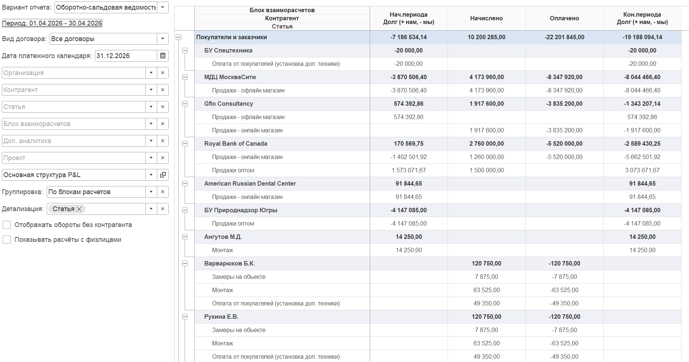

## УТ: реквизиты P&L и распределение приобретения товаров и услуг

В документе **«Приобретение товаров и услуг»** можно заполнить аналитику P&L и распределить расходы вручную или по автоправилам без перепроведения. Настройка **«Учитывать приобретение товаров, услуг и прочих активов по документам»** включает эти возможности. P&L распределяет только суммы из регистра **«Прочие расходы»**. При пустых реквизитах P&L и выключенном ручном распределении действует прежний расчёт.

[Как настроить и распределить расходы](./../p-l/dokumenty/dokumenty-dlya-upravlenie-torgovley/priobretenie-tovarov-i-uslug.md).

## Взаиморасчёты

Управленческий отчёт теперь показывает расчёты с физлицами и группирует задолженность по блокам, например по покупателям, поставщикам и подотчётным лицам.

{width=1858px height=979px}

[Как показать расчёты с физлицами и настроить блоки](./../p-l/vzaimoraschety.md).

## MCP: взаиморасчёты с контрагентами

В БП, УНФ и УТ ИИ-помощник показывает, кто и сколько должен на выбранную дату, как менялся долг за период и какие документы вошли в расчёт. Можно выбрать бухгалтерский учёт 1С или управленческий учёт P&L. Для управленческих данных задайте дату начала учёта взаиморасчётов.

[Настройки MCP и примеры запросов](./../p-l/nastroyki/nastroyki-mcp/_index.md).

## Поступление товаров: исключение из P&L

В БП и УНФ можно исключить из ОПиУ товары и материалы из поступлений, возвратов поставщику и авансовых отчётов. Услуги в тех же документах учитываются как обычно. Если вы ведёте [управленческие взаиморасчёты](./../p-l/balans/vzaimoraschety-2.md), движения по поставщикам сохраняются. Старые документы можно обработать без перепроведения.

[Как настроить исключение](./../p-l/dokumenty/isklyuchenie-po-postupleniyu-tovarov.md).

## Продажа валюты: отклонение курса

В БП результат продажи валюты показывается в кассовом ОПиУ и отдельной суммой в ДДС. При списании валюты переоценка остатка счёта 52 тоже попадает в оба отчёта. В ДДС платёж и переоценка показываются одной строкой, если совпадают статья и аналитика.

[Как настроить статью отклонения курса](./../p-l/nastroyki/dengi.md).

## Перемещение между кошельками

В БП, УНФ и УТ один документ переводит деньги между кошельками одной организации в одной валюте. Для отражения перевода в ДДС заполните обе статьи -- списания и поступления. В ОПиУ перевод не отражается.

На рабочем столе откройте **Деньги -> Инструменты -> Перемещение между кошельками**.

## ДДС: расшифровка операций и сохранение списка

В БП, УНФ и УТ щёлкните правой кнопкой мыши по сумме или названию статьи и выберите **«Расшифровать операцию»**. На вкладке **«Операции»** откроется список с отборами выбранной строки. Команда **«Сохранить»** выгружает весь список по этим отборам, в том числе в Excel.

## ДДС в УНФ: переводы в пути

Чтобы включить деньги в пути (счёт 57) в остатки на начало и конец периода, включите в отчёте ДДС вывод банковских средств и флажок **«Выводить остатки переводов в пути»**.

## Автоправила ДДС: дата начисления

В БП, УНФ и УТ флажок **«Отразить по методу начисления»** добавляет к кассовым движениям начисление на дату документа. Если снять флажок и повторно применить правило, оно уберёт созданные им начисления.

## ОПиУ: редактор формул

В БП, УНФ и УТ показатели отсортированы по алфавиту. Двойной щелчок по показателю вставляет его в позицию курсора или заменяет выделенный фрагмент формулы.

[Как создать формулу](./../p-l/opiu/struktura-otcheta-p-l/sozdanie-formuly.md).

## ОПиУ: пустые колонки

Денежные операции без данных ОПиУ больше не создают пустых колонок по проектам и другим аналитикам. План без факта сохраняется. Денежные движения по-прежнему видны в варианте **«P&L + Финансовый поток»**.

## Платёжный календарь: массовое создание по документам

В БП можно создать записи календаря сразу по нескольким проведённым документам. Выберите период и тип документов, отметьте готовые строки и запустите создание. Перепроводить документы не нужно.

[Как создать план по нескольким документам](./../p-l/platezhnyy-kalendar/massovoe-sozdanie-platezhnogo-kalendarya.md).

## Платёжные поручения: назначение платежа

В БП, УНФ и УТ текст назначения можно копировать из платёжного календаря и реестра платежей в одно или несколько поручений. В разделе **P&L -> Настройки -> Платёжный календарь** включите **«Переносить назначение платежа в платежное поручение»**.

## Приходная накладная УНФ: статьи и аналитика по счетам затрат

Для услуг от поставщика P&L может заполнить пустую статью, аналитику, проект или раздел по счёту затрат услуги. Заполненные поля шапки и ручное распределение имеют приоритет.

[Как настроить соответствие для приходной накладной](./../p-l/dokumenty/dokumenty-dlya-unf/prihodnaya-nakladnaya.md).

## Проекты: исправление расчёта рентабельности

В БП, УНФ и УТ в отчётах **«План-факт: общие показатели»** и **«План-факт с детализацией по периодам»** исправлен расчёт рентабельности и её отклонения от плана. При детализации по разделам итоговый процент считается по доходам и валовой прибыли проекта за выбранный период.

## Проекты: итоги и расшифровка факта по всем разделам

В БП, УНФ и УТ в отчёте **«План-факт: общие показатели»** с группировкой **«По разделам»** появился итог по каждому проекту. В нём видны доходы, расходы, валовая прибыль и рентабельность. Из колонки **«Факт»** в итоговых строках доходов и расходов можно открыть документы сразу по всем разделам проекта.
