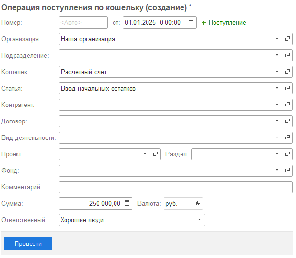
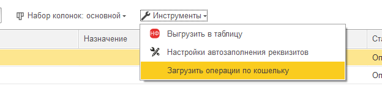
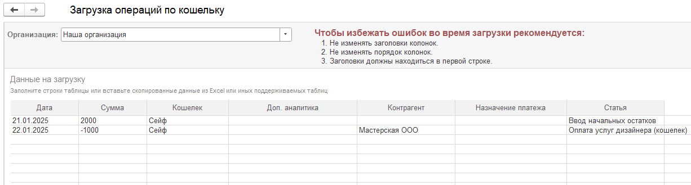

-  [Ввод начальных остатков](./vvod-nachalnykh-ostatkov-po-koshelku)

-  [Загрузка операции из EXCEL](./zagruzka-operaciy-po-koshelku-iz-excel-v-modul-pn)

-  [Настройка контроля остатков](./nastroyka-kontrolya-ostatkov-po-koshelkam)

-  [Перерасчет курса валют по кошельку](./pereraschet-kursa-valyut-po-koshelku)

Позволяет учитывать деньги предпринимателя, которые не отражаются в банке или в кассе. Данные операции будут отражаться в отчете ДДС.

### Учёт НДС по кошельку

Чтобы учитывать НДС, откройте карточку нужного кошелька и включите флажок **«Вести учёт НДС»**. У существующих кошельков он по умолчанию выключен. После включения в операции по кошельку, в том числе при создании из блока «Деньги», под суммой появятся поля **«Ставка НДС»** и **«Сумма НДС»**.

**Сумма операции уже включает НДС.** При выборе ставки сумма НДС рассчитывается из общей суммы; её можно скорректировать вручную. Если кошелёк валютный, сумму НДС вводят в валюте кошелька. При ручном распределении ставка и сумма НДС доступны в каждой строке. Если ставки в строках различаются, общая ставка в шапке операции остаётся пустой, а сумма НДС складывается из строк.

Выгрузка данных по кошельку содержит колонки **«Ставка НДС»** и **«Сумма НДС»**. В [загрузке операций из Excel](./zagruzka-operaciy-po-koshelku-iz-excel-v-modul-pn) можно передать сумму НДС; ставка при загрузке остаётся пустой. Если в строке указан НДС, а учёт НДС у выбранного кошелька выключен, строка получит ошибку: выберите другой кошелёк или включите флажок у текущего.

Движение денег отражается полной суммой операции. НДС учитывается в управленческих доходах и расходах согласно настройкам организации.

### Ввод начальных остатков

#### 1\. Через поступление

Чтобы начать вести учет по кошельку, достаточно создать **Поступление**, указав соответствующую дату, с которой [comment:airwP]начнется[/comment] учет по данному кошельку.

{width=610px height=533px}

#### 2\. Через ввод начальных остатков

[Ввод начальных остатков](./vvod-nachalnykh-ostatkov-po-koshelku)

### Загрузить операции по кошельку

Чтобы загружать операции из внешних файлов в систему, предусмотрен специальный инструмент.

1. Для этого необходимо зайти в **Инструменты** -> **Загрузить операции по кошельку**

   {width=624px height=159px}

2. В табличную часть достаточно вставить в соответствующие колонки данные и нажать **Далее**

   {width=1226px height=329px}

3. В следующем окне система покажет, каких элементов не найдено в системе и предложит их создать

   :::note ВАЖНО!

   При загрузке данных наименование контрагента должно совпадать с его названием в файле и с реквизитом "Наименование" в программе, в справочнике "Контрагенты".

   :::

   [image:./_index-4.png:::0,0,100,100::square,2.1396,36.9668,96.7342,12.7962,,top-left:888px:422px:center]

4. После того, как во всех строках будет указан статус **Ожидает загрузки** необходимо нажать **Загрузить**

5. [comment:08GRv]После загрузки[/comment] [comment:G5pHO]во[/comment] всех строках будет установлен статус **Загружено.** Работа с инструменто[comment:Unhq2]в[/comment] завершена, данные загружены.