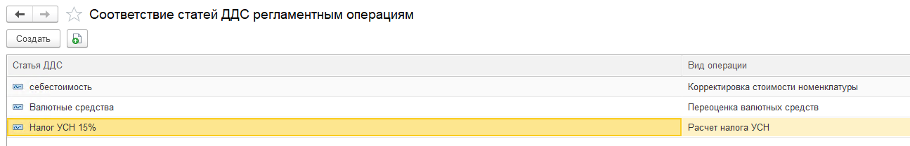

В **1С:Бухгалтерия предприятия** в  бухгалтерском учете при закрытии месяца выполняются регламентные операции (например, расчет себестоимости, переоценка валюты). Для целей управленческого учета по методу начисления необходимо отражать финансовый результат.

В системе реализовано соответствие статей с регламентными операциями.

:::tip 

На данный момент реализованы следующие операции:

-  Корректировка стоимости номенклатуры

-  Переоценка валютных средств

-  Расчет налога УСН

-  Амортизация и износ основных средств

-  Начисление налогов на единый налоговый счет

-  Расчет налога на прибыль

-  Расчет транспортного налога

-  Переоценка валютных средств

-  Амортизация НМА и списание расходов по НИОКР

:::

### **Шаг 1: Настройки соответствия**

Нужно перейти во вкладку настройки -> P&L

[image:./_index-2.png:::0,0,100,100::square,41.5698,64.5429,31.4922,8.3102,,top-left:1032px:361px:center]

Отразить по операциям статьи

{width=1295px height=209px}

Все последующие документы будут заполнятся автоматически. Операции по этим статьям будут отражаться в отчете ОПиУ методом начисления.

## Как заполняются реквизиты документа: приоритетность заполнения

Документ **«Регламентные операции»** в конфигурации **«Бухгалтерия предприятия»**. Отражает закрытие и регламентные суммы по виду операции. Источник статьи отличается от обычной продажи или денежного документа.

Общий порядок применения правил: [как заполняются реквизиты документов](../../kak-zapolnyayutsya-rekvizity-dokumentov). Здесь приведён порядок для этого документа.

### Доп. аналитика

Источник зависит от вида регламентной операции и её строки. Для всех операций единого порядка нет; источники по видам операций приведены ниже.

## Заполнение и запись

Значения задаются в доступном блоке «Реквизиты P&L» и реквизитах строки, где они предусмотрены. Автоправило ОПиУ с непустым значением может изменить поле шапки до сохранения; движение читает уже сохранённое значение. Этот этап отличается от выбора следующего источника для пустого поля.

## Особенности документа

- Источники статьи по виду операции: настройка виду регламентной операции; для списания РБП — соответствие статьи затрат статье РБП; для корректировки стоимости номенклатуры — подходящее соответствие параметров БП, затем статья вида операции.
- Доход или расход определяется типовыми суммами. Аналитики могут определяться строкой/соответствием конкретной операции; единого правила «шапка → строка» для всех операций нет.

## Контроль результата

После заполнения проверьте статью, сумму, период и аналитику движений P&L. Исключённая статья не заменяется умолчанием. Для пересчёта существующих данных применяйте явную команду P&L; изменение настройки само по себе не пересчитывает прошлые документы.
