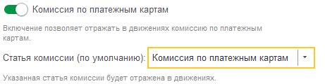
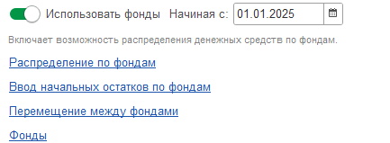
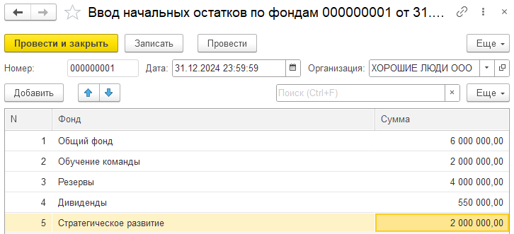
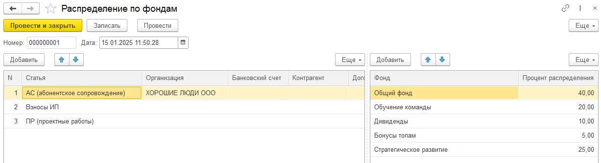

## Комиссия по платежным картам

В документе поступления на расчетный счет, если в качестве типа операции выбраны «Операции по платежным картам» и активировано отражение комиссии в настройках, то записи в регистры будут производиться с учетом суммы комиссии.

После активации этого учета необходимо указать статью комиссии, на которую будет зафиксирована соответствующая сумма.

{width=461px height=120px}

## Отклонение курса продажи валюты

В **Бухгалтерии предприятия** откройте **P&L → Настройки → Деньги** и заполните поле **«Статья отклонения курса продажи валюты»**. По этой статье будет отражаться разница при продаже валюты.

Когда проводится **«Поступление на расчётный счёт»** с операцией **«Поступления от продажи иностранной валюты»**, P&L сравнивает рублёвую стоимость проданной валюты с суммой полученных рублей. Если рублей получено меньше, разница становится расходом в ОПиУ по кассовому методу и отрицательным движением в ДДС. Если больше — расходы в ОПиУ уменьшаются, а движение ДДС положительное. При равных суммах отдельного движения нет.

Поступление рублей на банковский счёт отражается в ДДС отдельно на полную сумму. Переоценка валютных остатков из-за изменения курса не входит в отклонение при продаже.

## Фонды

:::info:true Что такое фонды?

**Фонды**-- это специально выделенные ресурсы, которые компания формирует для достижения конкретных целей. Они помогают эффективно управлять финансами, минимизировать риски и обеспечивать устойчивость бизнеса. Примеры фондов:

### **Резервный фонд**

Финансовая «подушка безопасности» компании, которая помогает справиться с непредвиденными трудностями, когда прибыль отсутствует.

### **Фонд на развитие**

Поддержка для бизнеса, которая позволяет ему расти, не жертвуя текущими задачами.

### **Фонд дивидендов**

Для регулярных выплат дивидендов своим акционерам/владельцам.

### **Фонд налогов**

Обеспечивает регулярную и своевременную оплату налогов и сборов

:::

Первичная настройка учета по фондам. Необходимо сначала активировать данный учет и указать дату начала использования данной системы.

{width=433px height=159px}

После необходимо ввести первоначальные остатки по фондам с помощью документа **Ввод начальных остатков по фондам**

{width=726px height=331px}

Далее необходимо задать правила распределения денежных поступлений на различные фонды.

Для этого необходимо создать документ **Распределение по фондам**

{width=1227px height=334px}

Слева задаютс[comment:pEweT]я по условия[/comment], справа - процентное соотношение, как будут распределяться денежные средства.

