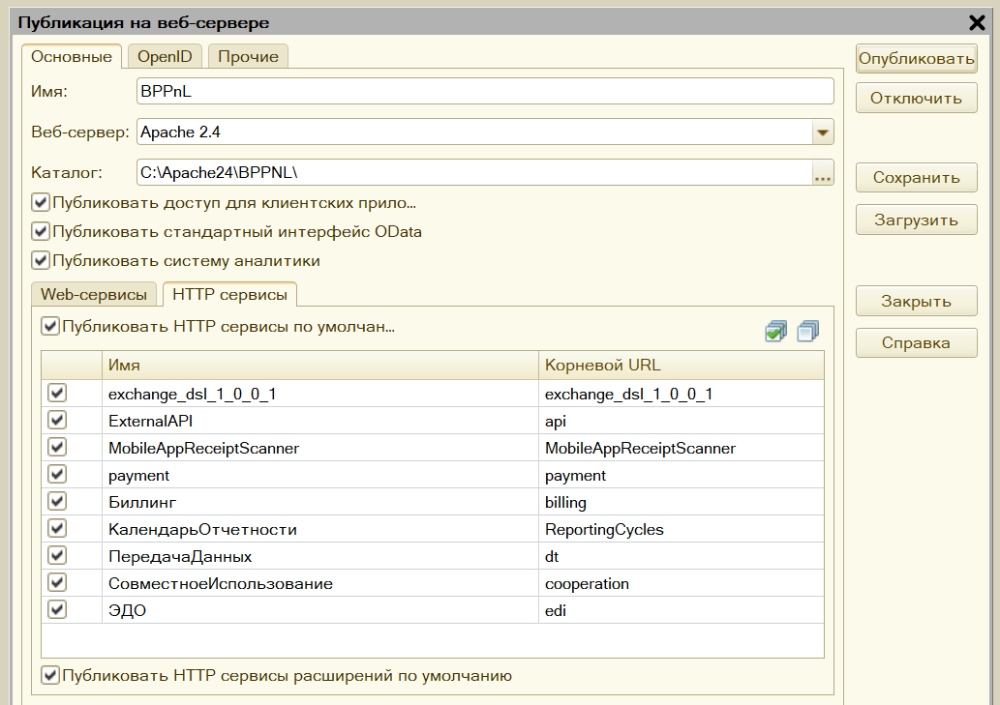
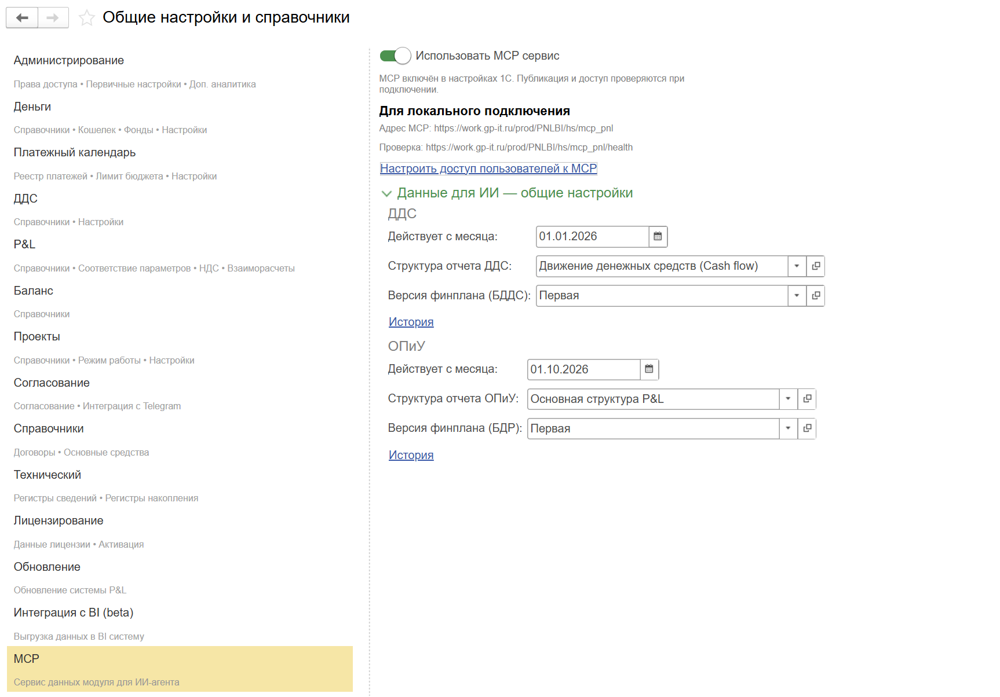
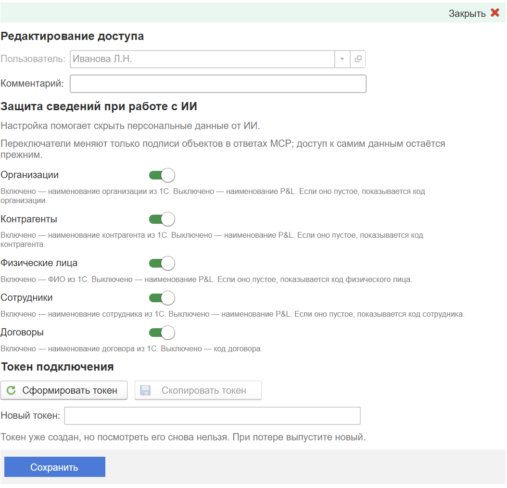

Чтобы MCP заработал, база 1С должна быть **опубликована на веб-сервере** (например, Apache), а её HTTP-сервис должен быть доступен с компьютера пользователя. Неважно, что вы настроите первым -- веб-сервер или программу с ИИ. Подключение заработает, когда готовы обе стороны.

### 1\. Подготовьте базу и публикацию

1. Опубликуйте базу на веб-сервере через **Конфигуратор -> Администрирование -> Публикация на веб-сервере**. Если база уже опубликована, проверьте её публикацию.
2. Включите **«Публиковать HTTP-сервисы расширений по умолчанию»**. Без этого HTTP-сервис P&L не будет доступен.

   {width=1033px height=729px}
3. Запишите адрес для подключения: `https://ваш-сервер/имя-публикации/hs/mcp_pnl`. Проверьте, что сервер доступен **с компьютера пользователя**. Адрес с `localhost` подходит только тогда, когда 1С и ИИ работают на одном компьютере. Для подключения через сеть используйте HTTPS.

### 2\. Дайте 1С права на чтение

Для подключения сотруднику понадобятся **личный токен MCP**, а также **логин и пароль пользователя информационной базы 1С**. Все эти данные сотрудник впишет в файл `Настройки.txt` в своей папке MCP.

**Рекомендуемый вариант — личная учётная запись сотрудника в 1С.** Если у него уже есть полные права доступа, он использует свой обычный логин и пароль. Если доступ ограничен, предоставьте ему право **«МСР: агент (только чтение)»**. Альтернатива — **«Управление финансами (полные права)»**, если сотруднику допустимо выдать полные права.

**Другой вариант — отдельный пользователь 1С для MCP.** Создайте его и назначьте права **«МСР: агент (только чтение)»** и стандартные права **«Только чтение»**. Передайте сотруднику логин и пароль этого пользователя для заполнения `Настройки.txt`. По возможности используйте первый вариант — личную учётную запись сотрудника.

В любом варианте проверьте, что выбранная учётная запись может читать нужные сотруднику данные P&L и 1С: право агента само по себе не открывает все финансовые данные.

### 3\. Включите MCP и настройте данные

Откройте **P&L -> Настройки -> MCP** и включите **«Использовать MCP сервис»**. В разделе **«Данные для ИИ -- общие настройки»** укажите действующие структуры ОПиУ и ДДС, месяц начала их действия и, если нужны планы, версии финансовых планов для БДР и БДДС.

{width=1726px height=1204px}

Если для запрошенного месяца структура не задана, ИИ получит ошибку `STRUCTURE_NOT_SET`. Если структуры менялись, сохраните настройки с месяца начала действия каждой структуры.

### 4\. Выдайте сотруднику личный токен

1. На странице MCP нажмите **«Настроить доступ пользователей к MCP»**.
2. В списке нажмите **«Создать»** и выберите сотрудника из справочника **«Пользователи»**. При необходимости добавьте комментарий, чтобы понимать, кому выдали доступ.

   {width=1063px height=1021px}
3. Выберите, показывать ли обычные наименования **организаций, контрагентов, физических лиц, сотрудников и договоров**. Когда переключатель выключен, для первых четырёх категорий передаётся наименование P&L, если оно заполнено, иначе код; для договора -- код.
4. Сохраните запись, нажмите **«Сформировать токен»**, затем **«Скопировать токен»**. Передайте токен именно этому человеку.

Исходный токен виден **только сразу после выпуска**. При повторном открытии записи пустое поле токена -- нормальное поведение: в базе хранится его хеш. Если токен утрачен, выпустите новый; старый сразу перестанет работать на всех устройствах. Чтобы закрыть доступ человеку, удалите его запись из списка. В каждой базе у него будет отдельный токен.

Переключатели меняют **наименования в структурированных ответах**. Они не ограничивают суммы и другие доступные данные. Текст, который кто-то вручную вписал в комментарий или назначение платежа, не скрывается.

### 5\. Проверьте подключение и передайте данные

После выдачи токена попросите сотрудника проверить подключение на компьютере, которому доступна публикация базы: он заполнит четыре строки файла `Настройки.txt` в своей папке MCP и запустит `Проверить.cmd` на Windows или `Проверить.command` на Mac. Сотрудник вводит свой логин и пароль 1С либо данные отдельного пользователя, если вы создали его для MCP. Успешный результат -- **«Связь с 1С есть»**. Проверка нужна именно с логином, паролем **и** токеном. Простое открытие `/health` в браузере без токена может вернуть `401` даже при исправной публикации.

Передайте пользователю:

- ссылку на актуальный архив папки MCP для системы пользователя -- Windows или macOS;
- адрес вида `https://ваш-сервер/имя-публикации/hs/mcp_pnl`;
- логин и пароль отдельного пользователя 1С, если вы создали его для MCP; в остальных случаях сотрудник использует свои;
- его личный токен MCP.

### Если проверка не прошла

| Что произошло | Что проверить |
|---|---|
| Нет связи с 1С | Доступен ли сервер с этого компьютера, опубликована ли база и включена ли публикация HTTP-сервисов расширений. |
| `401` | Верны ли логин, пароль и токен **этой** базы; не был ли токен заменён. |
| `403` или сообщение о правах | Включён ли MCP и хватает ли пользователю 1С прав на сервис и данные. |
| `404` | Верен ли адрес публикации и окончание `/hs/mcp_pnl`. |
| `STRUCTURE_NOT_SET` | Задана ли структура отчёта для запрошенного месяца. |
