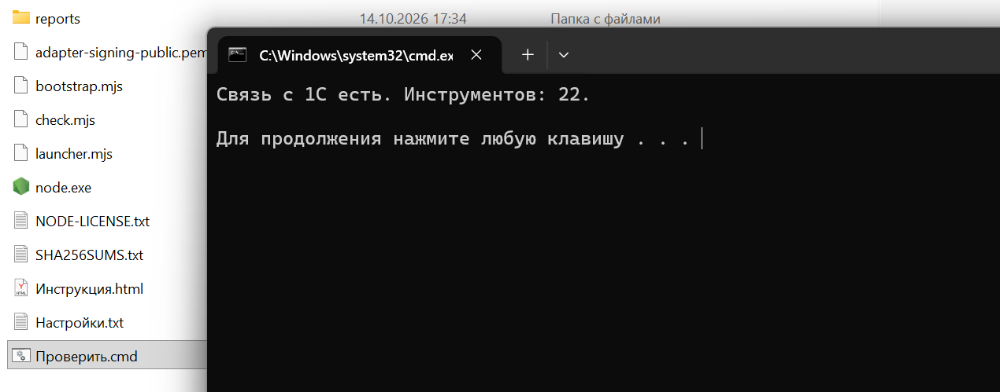

### 1\. Выберите папку для своего компьютера

Администратор даст вам ссылку на архив, адрес базы, логин, пароль и **личный токен**. Токен относится к конкретной базе. Если у вас две базы, попросите отдельный токен для каждой.

[tabs]

[tab:Для Windows]

**Скачать папку MCP для Windows:** **\[здесь будет ссылка для Windows\]**.

В архиве уже есть всё нужное, включая `node.exe` и файл проверки `Проверить.cmd`. Устанавливать Node.js отдельно не нужно.

[/tab]

[tab:Для macOS]

**Скачать папку MCP для Mac:** **\[здесь будет ссылка для macOS\]**.

Один архив подходит для Mac с **Apple Silicon и Intel**, если установлена **macOS 13.5 или новее**. Внутри уже есть Node.js и файл проверки `Проверить.command`; устанавливать Node.js отдельно не нужно.

Распакуйте архив для своей системы в удобное постоянное место, например в **Документы**. После подключения к ИИ не переносите папку: программа будет запускать файлы по её текущему пути.

[/tab]

[/tabs]

:::info:true Подробнее

Эта папка работает с **программой на вашем компьютере, которая умеет запускать локальный MCP-сервер (`stdio`)**. Например, это может быть Claude Desktop, Claude Code, Cursor, VS Code с поддержкой MCP или Codex с локальным MCP-подключением. Нужна именно поддержка локальных MCP в выбранной программе. **Обычный чат в браузере или приложение на телефоне не запустят папку с вашего компьютера.** При этом сама модель ИИ может работать через интернет: локально запускается папка MCP.

Инструкция подходит для **Windows и macOS**. Расширение 1С устанавливает администратор; скачивать его вместе с папкой не нужно.

:::

### 2\. Заполните четыре строки

Откройте в папке файл `Настройки.txt` в Блокноте Windows или TextEdit на Mac. После каждого знака `=` впишите данные от администратора:

```text
Адрес=https://ваш-сервер/имя-публикации/hs/mcp_pnl
Логин=логин 1С
Пароль=пароль 1С
Токен=личный токен MCP
```

Сохраните файл как обычный текст. Пароль может быть пустым, если так настроено подключение к 1С. Адрес и токен должны быть от **одной и той же базы**.

### 3\. Проверьте связь с 1С

Дважды откройте в этой же папке **`Проверить.cmd` на Windows** или **`Проверить.command` на Mac**. При первом открытии macOS может попросить подтвердить запуск. Если появилось сообщение **«Связь с 1С есть»**, переходите дальше. Если появилась ошибка, отправьте администратору **текст ошибки**. Не отправляйте заполненный `Настройки.txt`: в нём находятся пароль и токен.

{width=1186px height=474px}

### 4\. Подключите папку к ИИ

Откройте установленную программу с ИИ и покажите ей распакованную папку или сообщите полный путь к ней. Скопируйте **текст для своей системы**.

#### Вставьте следующий текст:

:::quote

Помоги подключить эту папку P&L MCP к твоему приложению. База 1С и доступ уже записаны в файле Настройки.txt; не открывай и не показывай его содержимое в чате.

Проверь, поддерживает ли твоё приложение локальный MCP. Если да, добавь сервер с именем pnl-mcp: команда -- полный путь к node.exe в этой папке, аргумент -- полный путь к bootstrap.mjs в этой же папке. Сохрани остальные мои MCP-подключения. Если не можешь менять настройки сам, покажи мне простые шаги для этого приложения.

Затем переподключи MCP, вызови health и list_structures. Скажи, работает ли связь с моей базой и какие структуры отчётов доступны. Ничего не меняй в 1С.

:::

:::info:true Если ИИ попросит заполнить настройки MCP вручную, укажите:

| Поле | Что указать |
|---|---|
| Тип подключения | Локальный MCP (`stdio`) |
| Имя | `pnl-mcp` |
| Команда | Полный путь к `node.exe` на Windows или к файлу `node` на Mac **в распакованной папке** |
| Аргумент | Полный путь к `bootstrap.mjs` **в той же папке** |

:::

Пароль и токен в настройках ИИ писать повторно не нужно: запускатель берёт их из `Настройки.txt`. После добавления MCP перезапустите программу с ИИ или переподключите MCP. Теперь можно спросить, например: **«Через P&L MCP покажи выручку и чистую прибыль по месяцам за этот год»**.

### Что делать потом

Новые инструменты и обновления адаптера приходят из расширения P&L в вашей базе. В обычной работе повторно скачивать папку не нужно. Если после обновления базы программа попросит переподключить MCP или перезапуститься, сделайте это.

Если файл проверки показывает связь, а ИИ не видит MCP, проверьте поддержку **локального `stdio`**, пути к `node.exe` или `node` и к `bootstrap.mjs`, затем перезапустите ИИ. Если токен потерян или перестал работать, попросите администратора выпустить новый.

:::note

Заполненная папка содержит пароль и токен. Храните её у себя и не пересылайте другим людям; для другого пользователя нужен чистый архив и его личный токен.

:::
