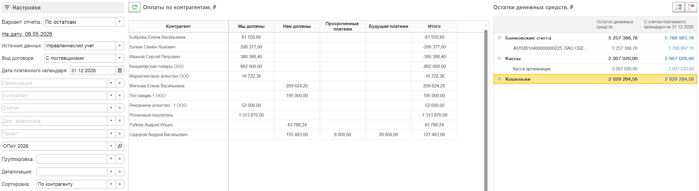
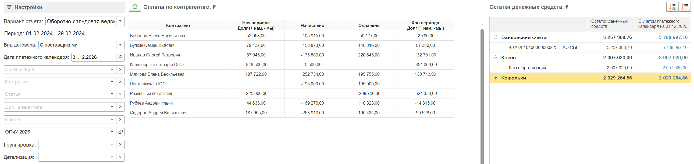
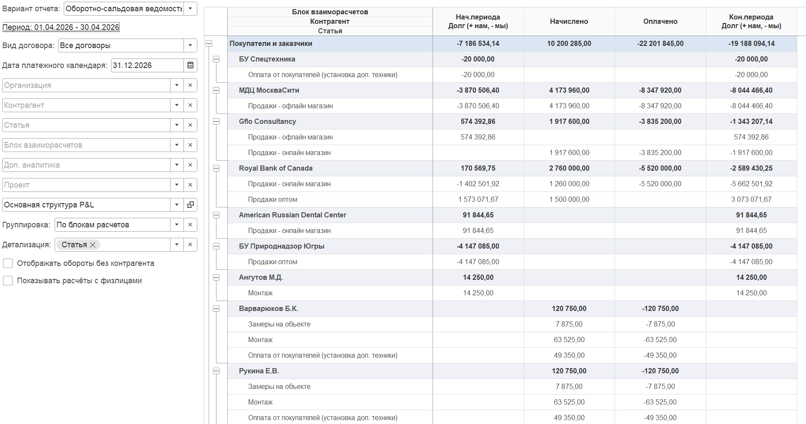
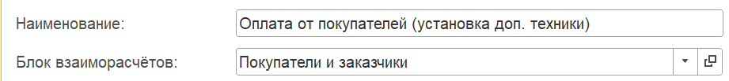
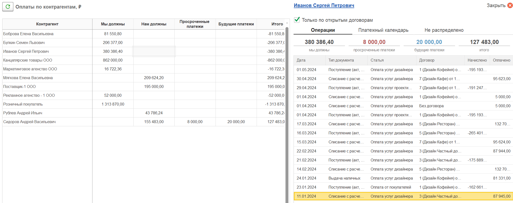

Отчёт «Взаиморасчеты» показывает, сколько должны компании, сколько должна сама компания и из каких документов сложилась задолженность. Откройте **1C:P&L -> Отчетность -> Взаиморасчеты**.

В Управлении торговлей форма отчёта на рабочем столе недоступна.

## Какой вариант отчёта выбрать

| Вариант | Когда использовать | Что показывает |
|---|---|---|
| **По остаткам** | Нужно узнать, кто и сколько должен на определённую дату | «Нам должны», «Мы должны», просроченные и запланированные платежи |
| **Оборотно-сальдовая ведомость (ОСВ)** | Нужно проследить, как менялся долг за период | Остаток на начало, начисления, оплаты и остаток на конец |

В варианте **«По остаткам»** выберите источник -- **«Бухгалтерский учет»** по данным 1С или **«Управленческий учет»** по данным P&L. Поле **«На дату»** задаёт дату задолженности, а **«Дата платежного календаря»** -- горизонт плановых платежей. В ОСВ укажите период. Она формируется по управленческому учёту.

{width=2568px height=706px}

{width=2581px height=613px}

## Как сформировать управленческий отчёт

1. Задайте дату начала учёта взаиморасчётов, заполните движения и внесите начальные остатки при переходе на учёт в P&L. [Настройка управленческого учёта взаиморасчётов](./balans/vzaimoraschety-2.md).
2. Выберите структуру ОПиУ. Из неё отчёт берёт метод учёта для каждой статьи. Если статьи в структуре нет, отчёт выделяет её цветом и применяет метод «Начисление».
3. Задайте нужные отборы. Можно выбрать организацию, контрагента, вид договора, статью, блок взаиморасчётов, проект и дополнительную аналитику.
4. Выберите группировку для верхнего уровня отчёта, а в поле **«Детализация»** укажите, что показать внутри каждой строки контрагента. Например, сгруппируйте результат по организациям, а внутри каждого контрагента раскройте договоры. В варианте «По остаткам» можно отсортировать строки по контрагенту или по суммам «Мы должны» и «Нам должны».

## Как сгруппировать задолженность по блокам

Блоки помогают отдельно видеть, например, долги покупателей, расчёты с поставщиками и подрядчиками, налоги и займы.

{width=1858px height=979px}

1. Откройте карточку статьи ДДС. В настройках P&L заполните поле **«Блок взаиморасчетов»**. Блок для каждой статьи выбираете вы. В справочнике есть 11 готовых блоков, можно добавлять свои блоки и подблоки.

   {width=921px height=103px}
2. В отчёте выберите группировку **«По блокам расчетов»**. Отчёт покажет блоки, внутри них -- контрагентов или физлиц, а при детализации «Договор» -- договоры контрагентов. Операции по статьям без назначения попадут в группу **«Не распределено»**.
3. Чтобы увидеть только один блок и его подблоки, выберите его в отборе **«Блок взаиморасчетов»**. Пустое поле показывает все блоки. Отбор действует и при других группировках.

Отчёт использует текущий блок из карточки статьи, в том числе за прошлые периоды. При смене блока история переместится в новую группу при следующем формировании. Для этого достаточно изменить карточку статьи.

В группировке по блокам остатки по статьям одного блока могут свернуться внутри одной организации, контрагента и договора. Например, если в одном договоре остатки по двум статьям составляют 10 000 ₽ в «Нам должны» и 10 000 ₽ в «Мы должны», итог по договору в одном блоке будет нулевым. Если статьи отнесены к разным блокам, обе суммы будут видны в своих блоках.

## Как показать расчёты с физлицами

В управленческих отборах включите **«Показывать расчёты с физлицами»**. Флажок по умолчанию снят. Он добавляет к расчётам с контрагентами движения P&L по физлицам в обоих вариантах отчёта. ФИО выводится на уровне контрагента. Чтобы увидеть физлиц, оставьте отбор **«Контрагент»** пустым и снимите ограничение по виду договора.

В 1С:Бухгалтерии так можно проверить подотчёт. Например, если сотрудник получил 20 000 ₽ и отчитался за 17 000 ₽, остаток 3 000 ₽ попадёт в «Нам должны». При группировке по блокам ищите эти расчёты в блоке **«Подотчётные лица»**. В отчёт попадают суммы, для которых уже сформированы движения P&L.

В ОСВ отдельный флажок **«Отображать обороты без контрагента»** добавляет операции, у которых пусты оба поля -- контрагент и физлицо. Каждый флажок действует независимо.

## Как проверить сумму

Нажмите на сумму в строке. В расшифровке видны документы и операции, из которых она сложилась. Например, чтобы проверить, откуда взялся долг подотчётного лица, откройте его остаток и проверьте выдачу, авансовый отчёт и возврат. Для плановых и просроченных сумм по контрагентам расшифровка показывает данные платёжного календаря.

{width=2097px height=831px}

В варианте «По остаткам» справа также можно посмотреть фактический остаток денег на счетах и в кассе и прогноз с учётом платёжного календаря.
